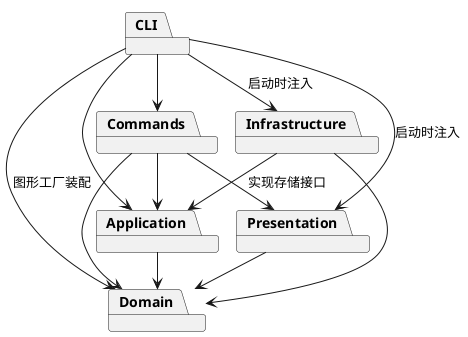

# Lab1 Phase 1：SVG 编辑器（CLI）

## 项目说明

这是本次 Lab1 Phase 1 的课程作业，使用 TypeScript 实现了一个命令行 SVG 编辑器。目前支持 rect、circle、ellipse、line、text、g 六种图形，可以创建和修改图形、调整分组、撤销重做，以及读写 SVG 文件。

- **Git 仓库地址：[https://github.com/zxy0303/svg-editor-cli-lab1](https://github.com/zxy0303/svg-editor-cli-lab1)**
- 最终版本：[final 标签](https://github.com/zxy0303/svg-editor-cli-lab1/tree/final)
- 课程要求：[phase_cli_1.md](https://github.com/zxy0303/svg-editor-cli-lab1/blob/final/phase_cli_1.md)

仓库已公开，代码和分步提交记录都可以直接查看。本文对应工程中的 `doc/README.md`，下面按课程要求说明架构、开发过程、自查结果和测试情况。

## 运行方法

需要 Node.js 22 或更新版本，以及 npm。

```sh
git clone https://github.com/zxy0303/svg-editor-cli-lab1.git
cd svg-editor-cli-lab1
git checkout final
npm ci
npm run cli
```

进入程序后，可以输入 `help` 查看全部 19 个命令，按 Ctrl+D 结束。检查项目可以运行：

```sh
npm run check
```

这条命令会依次进行编译、严格类型检查和自动化测试。也可以先运行 `npm run build`，再通过 `npm start` 启动编译后的程序。

课程中的两个案例保存在 `examples/` 下，可以直接执行：

```sh
npm run --silent cli < examples/flowchart.commands
npm run --silent cli < examples/session.commands
```

第一条生成两节点流程图；第二条对应题目的典型会话，其中非法分组和 save 后 undo 的两条报错是题目预期的结果，程序会继续运行。

## 一、架构方案

### 1. 模块划分

我把图形本身的行为、命令处理和文件读写分开，希望后面改动某一部分时，不用同时修改整个程序。具体分成下面几个模块。

| 目录 | 主要负责的内容 |
| --- | --- |
| `src/domain/` | 图形、容器和文档，以及平移、缩放等操作，不负责终端输出和文件读写 |
| `src/application/` | 管理当前文档、执行编辑操作、记录撤销重做历史，并定义 SVG 存储接口 |
| `src/commands/` | 将每条命令封装成对象，检查参数并调用对应操作 |
| `src/cli/` | 拆分输入参数、找到命令、逐行读取输入、统一输出错误，以及启动时的对象装配 |
| `src/infrastructure/` | 解析和生成 SVG XML，读取和保存本地文件 |
| `src/presentation/` | 生成 tree 和 show 的文字输出 |
| `test/`、`examples/` | 自动化测试、示例命令和 SVG 文件 |

模块关系如下。图是用 PlantUML 在本地生成的，[源码在这里](https://github.com/zxy0303/svg-editor-cli-lab1/blob/final/doc/architecture.puml)。为方便单独阅读这份 README，图片和源码都使用完整链接。




### 2. 设计模式的选择

**Command 是这次作业要求使用的模式。** 每种命令都有对应的类，编辑命令继承 `EditCommand`，通过统一的 `execute` 方法执行。具体修改放在 `apply` 中，再由 `Editor` 负责保存修改前后的状态。这样，一条编辑命令就对应一次撤销或重做。

**Composite 用来处理容器和普通图形。** `Shape` 定义平移、缩放、属性设置和克隆等共同操作；`Group` 保存子图形，普通容器的移动和缩放递归调用子图形的操作。如果容器或子树已有 transform，移动时在容器原有变换外侧增加平移，让整组一起移动。命令仍通过同一个 move 接口操作图形。

撤销重做采用了 **Memento（备忘录）** 的思路：编辑前后各保存一份文档副本。分组、解组会同时改变父子关系和节点顺序，逐条编写反向操作比较容易遗漏，所以这里先选择完整快照。缺点是每次编辑都需要复制文档，文档越大、历史越多，占用的时间和内存也越多；本阶段的示例规模较小，可以接受这个取舍。

文件读写通过 `SvgStorage` 接口隔开：应用层只使用接口，`FileSvgStorage` 提供实际实现，命令类不直接操作文件系统。

对应的主要代码如下：

| 内容 | 代码位置 |
| --- | --- |
| 命令基类和编辑命令 | `commands/Command.ts`、`commands/EditCommand.ts`、各 `*Command.ts` |
| 执行编辑和管理当前文档 | `application/Editor.ts` |
| 撤销重做历史和文档副本 | `application/History.ts`、`application/EditRecord.ts` |
| 图形共同操作和容器递归 | `domain/Shape.ts`、`domain/Group.ts` |
| 叶子图形的几何属性处理 | `domain/GeometryShape.ts` 及各图形类 |
| SVG 存储接口和文件实现 | `application/SvgStorage.ts`、`infrastructure/FileSvgStorage.ts` |

按名字选择实现的地方只有两处：`CommandDispatcher` 根据命令名找到命令，`ShapeFactory` 根据图形类型创建对象。这两处按课程要求记为**待重构项**，后续插件化时可以改成注册方式，本阶段先不实现完整插件系统。

### 3. 依赖方向规则

模块之间按下面的方向引用，同一个模块内部可以相互引用。架构图中的箭头也表示这些方向。

| 模块 | 可以依赖的其他模块 | 这样安排的原因 |
| --- | --- | --- |
| domain | 无 | 图形和树结构可以独立使用，不绑定输入输出方式 |
| application | domain | 只组织文档和历史，不处理终端或磁盘细节 |
| presentation | domain | 根据模型生成显示内容 |
| infrastructure | application、domain | 实现存储接口，完成 SVG 和模型之间的转换 |
| commands | application、domain、presentation | 执行用户命令，需要操作文档并返回显示结果 |
| cli | 其余五个模块 | 启动时把工厂、存储、命令和显示对象组合起来 |

Node.js 的输入输出和第三方运行依赖只放在 CLI 或基础设施中，领域层不反过来依赖命令、显示和文件系统。`test/architecture.test.ts` 会检查目前使用的静态 import；如果发现违反约定的依赖，需要修改代码，或说明调整方案的原因。

### 4. 可能的变化

如果后续继续做这个项目，我认为下面几处比较可能发生变化：

| 可能变化的地方 | 目前的处理方式 |
| --- | --- |
| 增加图形类型，包括后续的 box | 保留共同的图形操作接口，把类型选择集中在工厂中。box 和插件加载不属于这次作业，暂时不做 |
| 增加命令或改用图形界面 | 每条命令单独封装，核心操作不依赖 REPL，后续可以复用 |
| 大文档下的撤销性能 | 历史集中在应用层，先保证结果正确，以后再考虑差量记录 |
| 改变保存位置或方式 | 使用存储接口，目前只实现本地文件 |
| 调整 tree/show 的格式 | 单独放在展示层，不让图形类负责打印文字 |
| 支持更多 SVG 语法 | 当前只处理课程要求的六类图形，遇到不支持的元素会报错，避免保存时悄悄丢失内容 |

## 二、过程记录

这次作业使用 Codex 辅助实现和检查。下面按实际开发日期，记录几个比较关键的问题，以及对应的修改和测试结果。

### 2026-10-26：搭建项目并完成主要功能

开始时先根据 `phase_cli_1.md` 区分本阶段功能和后续插件功能，确定只实现六类图形。项目按“工程和方案 → 图形模型 → 命令和历史 → SVG 读写 → 检查和文档”的顺序分步提交。

这一轮主要处理了以下问题：

- `#` 只能用于整行注释，不能把颜色参数当成注释；带空格的文字需要保留引号信息，文字内容 `"in"` 也不能误认为父容器子句。
- `scale` 要同时缩放位置和尺寸；移动或缩放容器时，要递归处理所有子图形。`front` 对应 SVG 中后绘制的节点，因此移到同级末尾，`back` 则移到开头。
- 分组按原文档顺序收编图形，而不是按命令参数顺序。题目没有规定新容器放在哪里，这里选择第一个被选图形原来的位置。根级容器按题目要求不能 ungroup。
- 撤销测试中专门构造了“前面的子图形已缩放，后面的坐标溢出”的情况，确认失败后能还原整组内容，不会留下部分修改。
- 自动补 ID 的初稿存在顺序问题：前面的匿名矩形可能先占用后面已有的 `rect1`。后来改为先收集所有显式 ID，再给缺 ID 的元素命名，并加入冲突测试。
- 最初把 `save B.svg` 当成修改默认保存路径。重新对照题目后，改为无参数 save 始终使用最近一次 read 的路径；init 后即使另存过，也仍需显式指定保存路径。`group` 的新 ID 也补上了与 create 相同的校验。
- SVG 保存和读回时，XML 会把文字中的回车归一化。后来将回车写成 `&#13;`，并测试中文、emoji、回车、换行和 tab 能否保留。
- 严格编译需要显式加入 Node 类型；测试环境不支持 tsx CLI 创建 IPC 管道，因此改用 `node --import tsx` 启动。架构图使用本地 PlantUML 和 Smetana 生成，不需要把 Java 或绘图工具作为项目运行依赖。

检查架构图时，还发现初稿漏画了 CLI 对 `ShapeFactory` 所在领域层的依赖，随后补齐了图和依赖规则。代码中增加了静态 import、一类一文件等检查，并配置 GitHub Actions 在 Node.js 22、24 上运行。

这一轮结束时，本地和远程的 32 项测试通过，两个课程案例也完成了回放。流程图使用本地 SVG 渲染检查了矩形、连线和中文文字；没有把这个结果当作浏览器兼容性测试。

### 2026-10-28：补查 SVG 输入边界

第一次复查发现，`create text` 可以接受 NUL 字符，直到 save 时才失败；外部 SVG 的 `&#0;` 也能绕过源文本检查。这说明只在保存时校验还不够。

先加入 3 项能复现问题的测试，再把 XML 字符校验集中到领域层的 `Value` 中，在文字、样式和导入属性进入模型时检查。修改后，非法 create、set、read 都不会改变当前文档或 redo 历史，合法中文和换行仍能往返保存，测试增加到 35 项。

第二个问题是对 `<!DOCTYPE`、`<!ENTITY` 的关键词扫描过于简单，会误拒绝注释或 CDATA 中的普通文字。后来改为检查 XML 解析结果中的 doctype，真正的 DTD 仍然拒绝，普通内容则正常保留。新增回归测试后，共 36 项测试通过。

这两次修改都沿用原来的模块划分，没有增加图形类型或命令，修复和文档更新分别提交。

### 2026-10-29：检查分组恢复和属性显示

这一天先补查跨父级分组、嵌套解组的撤销重做。新增的 2 项测试确认：分组后子树和顺序不丢失，一次 undo 能恢复原父级和兄弟位置；解组后的子节点占据原组的位置，两侧兄弟不受影响。这两项在已有实现上就通过了，因此属于补充测试，没有修改业务代码，测试总数为 38 项。

随后检查 tree/show 时，发现带换行或 tab 的合法属性值会把一条显示拆成多行。先用测试复现，再修改 `TreePresenter`，对带空白的属性值加引号并转义显示。实际存储值和撤销重做不受影响，修改后共 39 项测试通过。

### 2026-10-30：最后检查和整理提交文件

这次发现显式写了 `xmlns=""` 的元素也会被当成 SVG 读入，保存后反而变成 SVG 元素，改变了原文件的含义。补充 2 项回归测试后，收紧了命名空间检查：显式空命名空间和其他非 SVG 命名空间会报错；标准 SVG、带前缀的 SVG，以及解析器原来支持的省略 xmlns 的输入仍可读写。失败 read 不会替换文档、默认路径或 redo，也不会输出临时补 ID 的警告。修改后共 41 项测试通过。

最后从已提交内容导出一份到独立目录，重新安装依赖，再次通过编译、类型检查和全部测试。编译后的 CLI 也重新执行了两个课程脚本，输出用另一个 XML 解析器检查：流程图有 8 个元素，典型会话保存文件有 5 个元素，ID 均唯一；典型会话只出现题目预期的两条错误。

另外用临时检查脚本逐项验证了 36 个允许的 set 属性组合及其 undo/redo、六类图形的 in 子句、help 中的 19 个命令，以及容器平移缩放后的全部几何属性。这部分属于额外检查，没有计入项目内的 41 项测试。

提交前，仓库由私有改为公开，README 中补上仓库地址和 final 链接，图片也改用完整地址，方便在课程系统中单独阅读。开发历史保留在 Git 中，最终版本使用 `final` 标签。

### 2026-10-31：修正导入图形后的容器移动

从评阅角度重新检查时，课程背景中的嵌套变换示例暴露了一个遗漏：执行 `move diagram 10 0` 后，普通矩形移动了 10px，但 `scale(0.8)` 子组里的矩形只移动了 8px，组内相对位置发生了变化。原来的测试只检查 transform 能否保留，没有检查整组移动后的实际位置。

先补充 2 项回归测试，确认旧实现都失败，再修改 `Group.move`。当容器或子树已有 transform 时，在容器原有变换外侧增加平移，保留子图形原来的几何值和变换；没有 transform 的容器仍递归修改子图形坐标。这样可以处理这次发现的问题，也不用增加新的图形类型、命令或依赖。

修改后共 43 项测试通过。新增测试检查了课程原始 SVG、连续移动、一次一次撤销和重做、保存读回，以及带旋转、矩阵、反射和零缩放的子树。另用编译后的 CLI 运行课程原始 SVG，并用本地 SVG 渲染器比较移动前后的图像，确认整张图恰好向右平移 10px，没有局部位移差异。两个原有课程案例也重新执行通过。

这次只修正容器 move 的整体移动问题。移动的增量以该容器的父坐标系为准；叶子图形的几何编辑、scale 和跨容器调整归属仍按下面说明的范围处理。修复和文档更新分开提交，最终版本继续使用 `final` 标签。

## 三、一致性自查

### 1. 实际模块与方案是否一致

目前一致。源码仍然是 `domain`、`application`、`commands`、`cli`、`infrastructure`、`presentation` 六个模块，`src/cli.ts` 只负责启动。`test/`、`examples/`、`.github/workflows/` 和 `doc/` 分别放测试、示例、自动检查配置和文档。

图形数据通过私有字段保存，读取子节点集合时返回副本；生产代码中的类保持一类一文件，文件名与类名一致。接口和输入参数类型只用于模块之间传递信息，图形本身仍通过类的方法完成操作。

### 2. 依赖方向是否符合方案

目前静态 import 检查通过，代码中没有发现违反上面依赖规则的引用。核对的例子包括：

- `Shape`、`Group`、`SvgDocument` 只引用领域类，不读写文件。
- `Editor` 使用本层的历史类、存储接口和领域模型，不引用 `FileSvgStorage`。
- `FileSvgStorage` 实现 `SvgStorage`，实际文件读写放在基础设施中。
- `Main` 在启动时注入文件存储，`CommandDispatcher` 负责建立命令对象。
- `TreePresenter` 只读取领域模型，展示层不会反过来调用命令。

方案中实际调整过的地方如下：

| 调整 | 原因 |
| --- | --- |
| 补上 CLI → Domain 的依赖 | CLI 需要使用图形工厂，初稿漏画，后来同步修改了图、规则和检查 |
| 增加静态检查和 GitHub Actions | 用来重复检查模块约定，没有改变业务分层 |
| PlantUML 使用 Smetana 布局 | 便于在本地生成架构图，不需要系统安装 Graphviz |
| XML 字符校验放入已有的 Value 类 | 让编辑和导入使用同一规则，没有新增模块或改变依赖方向 |
| 修正带变换子树的容器移动 | 只调整已有 Group 类的 move 实现，命令接口、模块和依赖方向保持原样 |

静态检查只覆盖当前使用的常规 import，不能单靠它判断架构是否合理。命令分发和图形工厂的注册化仍保留为后续待重构项。

## 四、质量保证手段

### 1. 自动化测试

截至 2026-10-31，`npm run check` 可以通过生产代码编译、源码和测试的严格类型检查，以及 43 项自动化测试。

| 测试文件 | 数量 | 主要检查内容 |
| --- | --- | --- |
| `domain.test.ts` | 7 | 五类叶子图形的几何操作、容器递归、克隆、ID、层级和顺序 |
| `commands.test.ts` | 14 | 六类创建、各编辑命令的撤销重做、历史规则、属性白名单、参数解析、失败回滚和显示转义 |
| `svg.test.ts` | 18 | SVG 往返、自动 ID、属性保留、变换容器的整体移动、文件失败、默认路径、XML 字符、注释、CDATA 和命名空间 |
| `cli.test.ts` | 2 | 启动真实 CLI 子进程，执行课程典型会话和流程图案例 |
| `architecture.test.ts` | 2 | 模块依赖、一类一文件和顶层函数声明检查 |

测试不只检查正常结果，也检查报错后原状态是否保留。例如文件不可写、读取失败、坐标溢出时，都需要保证当前文档和历史不被破坏。保存时先写同目录临时文件，再替换目标文件，减少写入失败损坏原文件的可能。

10 月 28 日新增的 4 项、10 月 29 日属性显示的 1 项和 10 月 30 日命名空间的 2 项测试，都先在修改前复现了问题，再验证修复。10 月 29 日分组和解组的另外 2 项测试是补充覆盖，在原实现上直接通过，这两种情况在过程记录中分开说明。

10 月 31 日新增的 2 项测试同样先验证旧实现会失败。测试根据 SVG 变换规则计算矩形四角的位置，检查整组位移和形状是否保持，不只比较 transform 字符串；另外保留了本地渲染的独立检查结果。

### 2. 对照课程功能检查

| 课程要求 | 当前结果 |
| --- | --- |
| 文档操作 | init/read/save/canvas；默认画布 800×600，无参数 save 使用 read 的路径，canvas 查询不影响历史 |
| 六类图形和创建归属 | rect/circle/ellipse/line/text/g 均支持 create 的 in 子句，未知类型包括 box 会报错 |
| 图形编辑 | delete/move/scale/set/group/ungroup/addto/front/back；容器和叶子使用相同的命令入口，带嵌套变换的容器 move 保持整组位移一致 |
| 撤销重做 | 一条编辑一个单元，新编辑清空 redo；init/read/save/修改画布成功后禁止 undo/redo，下一次编辑后恢复 |
| 显示 | tree 显示层级和关键几何属性，tree id 只显示对应子树，show 包含父级信息，help 列出全部语法 |
| 输入和错误 | svg> 提示符、整行注释、带空格参数、浮点数、大小写敏感的唯一 ID；错误统一以 error: 开头，失败不改变状态 |
| SVG 读写 | 缺 ID 自动补全并警告，保存后可以读回；检查 XML 字符和命名空间，注释与 CDATA 不再因关键词被误拒绝 |

终端交互检查覆盖了提示符、逐行输入、中文带空格文字和 show。脚本模式省略提示符，便于执行示例。两节点流程图的本地渲染结果如下：


### 3. 检查结果和目前的限制

本地使用 Node.js 25.8.1，10 月 31 日修正后共有 43 项测试通过。GitHub Actions 在 Node.js 22、24 的 Linux 环境运行干净安装和完整检查，本次修复也已通过，见[10 月 31 日检查记录](https://github.com/zxy0303/svg-editor-cli-lab1/actions/runs/41188683638)。10 月 30 日的 41 项测试记录保留在[这里](https://github.com/zxy0303/svg-editor-cli-lab1/actions/runs/41037704601)。临时脚本的 36 个属性组合检查和独立 XML 解析也通过，未重复算入测试数量。

目前还有以下限制：

- 撤销重做保存整份文档快照，适合本次作业的小型示例，还没有针对大文档做性能优化。
- 只支持课程要求的六类图形。path、tspan、defs 等其他元素，非 SVG 命名空间、损坏 XML 和 DTD/实体声明会报错，不是完整的 SVG 编辑器。
- 几何参数使用纯数值，根元素宽高额外接受 px；百分比和其他单位暂未实现。
- 导入的 transform、字体和 data-* 等额外属性可以保留，但 set 仍只接受题目规定的白名单。带变换子树的容器 move 已修正，平移在该容器的父坐标系中进行。
- 已有 transform 不展开为几何值；叶子图形的几何编辑和 scale 仍处理局部坐标属性。跨变换容器的 group/addto/ungroup 不做画布坐标补偿，不保证画布位置不变；canvas 修改尺寸时会重设 viewBox。
- 流程图通过本地 SVG 渲染检查了图形和中文显示，由于内置浏览器不能打开本地文件，没有完成浏览器兼容性测试。
- box、插件系统和图形界面属于后续阶段，这次没有实现。

### 4. 提交说明

代码、测试和文档已分步提交到 [GitHub 仓库](https://github.com/zxy0303/svg-editor-cli-lab1)，保留了 10 月 26 日至 31 日的开发和修改记录。最终版本使用已推送的 `final` 标签。课程系统提交的文件为本 README，截止日期为 2026-10-31，具体时间以课程平台为准。

参考说明：[SVG 坐标与变换](https://www.w3.org/TR/SVG11/coords.html#TransformAttribute)、[PlantUML](https://plantuml.com/text-encoding)、[GitHub checkout](https://github.com/actions/checkout)、[GitHub setup-node](https://github.com/actions/setup-node)。
