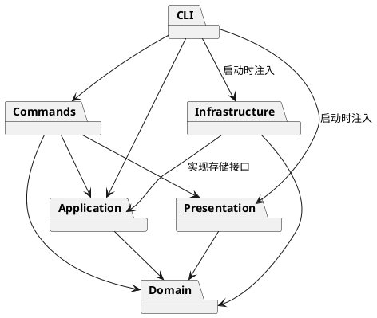

# Lab1 Phase 1：架构与开发记录

## 一、架构方案

### 1. 模块划分

| 目录 | 职责 |
| --- | --- |
| `src/domain/` | 封装图形、树结构、文档与几何行为；不依赖命令行或文件系统 |
| `src/application/` | 当前文档、编辑事务与历史管理；声明 SVG 存储接口 |
| `src/commands/` | 每条命令的对象与执行规则；编辑命令实现 Command 协议 |
| `src/cli/` | 分词、命令分发、REPL、统一错误输出与启动装配 |
| `src/infrastructure/` | SVG XML 解析与序列化、本地文件读写 |
| `src/presentation/` | 结构树和属性明细的文字展示 |
| `test/`、`examples/` | 自动化验证、可回放命令与外部 SVG 样例 |

架构图源码如下；独立源码也将保存在 `doc/architecture.puml`。

### 2. 设计模式的选择

- **Command（必选）**：编辑操作封装为独立命令对象，统一执行与撤销/重做。一条命令对应一个历史单元。
- **Composite**：抽象图形统一定义平移、缩放、属性和克隆；`Group` 持有子图形，递归执行几何操作；叶子图形只处理自身属性。
- **Memento**：编辑前后保存封装的文档副本。失败时恢复副本；历史用副本恢复整棵树、顺序和属性，避免每条复杂结构操作分别编写易错的逆操作。代价是每次编辑的时间、内存与文档大小成正比，适合本阶段小型文档。
- **依赖倒置**：应用层声明 SVG 存储接口，基础设施实现；命令不直接操作磁盘。
- **图形工厂 / 命令分发（待重构）**：仅这两处按名字选择实现。后续可改为插件注册，本阶段不建设完整插件框架。

### 3. 依赖方向规则

图中箭头表示允许的直接依赖。领域层不依赖其他业务模块，应用层只依赖领域层；基础设施通过实现应用层接口被注入。展示层只读取领域对象。命令层使用应用层、领域层和展示层；CLI 为组合根，负责装配具体实现。禁止领域层反向调用命令、展示或文件系统。实现后检查 import 并记录差异。

### 4. 变化点假设

| 变化点 | 本阶段决策及理由 |
| --- | --- |
| 新增图形 / `box` 插件 | 统一图形协议并集中工厂分发；不实现 `box`、插件加载和恢复规则，因为不在 Phase 1 范围 |
| 新增命令与交互渠道 | 独立命令对象与应用层；REPL 仅负责文本输入输出，后续 GUI 可复用核心 |
| 撤销策略 / 大文档性能 | 历史集中管理；先用快照保证结构还原正确，未来可替换为差量历史 |
| SVG 存储介质 | 以接口隔离本地文件系统，测试可使用内存替身 |
| 显示格式 | 单独的展示类生成 tree/show，领域对象不打印 CLI 文本 |
| 任意完整 SVG 语法 | 本阶段实现六类图形与所需属性；超出范围的输入应显式处理，避免静默丢失 |

## 二、过程记录

### 2026-10-26 · 第一步：工程与方案

- 阅读 `phase_cli_1.md`，先区分 Phase 1 与未来插件阶段，确认 `box` 不实现。
- 采用分步 Git 提交，先建立严格类型检查和目录职责，再实现功能。
- 在需求审阅中识别两个容易误读的点：`#` 仅在注释行开头生效，颜色参数仍需保留；根级 `g` 按题目要求禁止 `ungroup`，即使常规编辑器可能允许。
- 架构方案选择 Command + Composite，并计划使用快照处理复杂结构的撤销和失败原子性，接受小型文档下的复制成本。
- 首次严格编译发现 Node 类型未被自动包含，显式配置 `types: ["node"]`，并启用 `noEmitOnError` 防止编译失败仍产出可运行文件。

后续在每个实现阶段补充实际发现、验证和修正，不以生成代码代替过程记录。

### 2026-10-26 · 第二步：领域模型

- 实现六类图形、嵌套容器和文档，字段私有；读取集合返回副本，避免调用方直接修改内部数组。
- 明确 `scale` 缩放位置和尺寸，而非只改大小；容器递归处理叶子。样式保留在容器上，使用 SVG 原生继承语义。
- 明确 SVG 后绘制的元素位于前方：`front` 移到兄弟末尾，`back` 移到开头。
- `group` 按原文档深度优先顺序收编，在第一个被选节点的位置插入新容器，跨父级也保持原遍历相对顺序；题目未规定新容器位置，这里作出确定性选择。
- 先测试几何、克隆、唯一 ID、容器层级、循环拒绝和顺序，再开始 CLI 集成。
- 测试环境禁止创建 tsx CLI 的 IPC 管道，改用 Node 原生的 `--import tsx` 启动；同样执行 TypeScript，但不依赖额外监听管道。

## 三、一致性自查

当前尚为工程骨架，实际模块与依赖将在实现完成后核对。若方案调整，记录原因与最终目录，不宣称尚未验证的内容已通过。

## 四、质量保证手段

计划以严格 TypeScript 编译、领域单元测试、命令集成测试、SVG 往返测试、CLI 脚本回放与浏览器预览共同验证。最终在此记录实际执行的检查、结果和限制。
