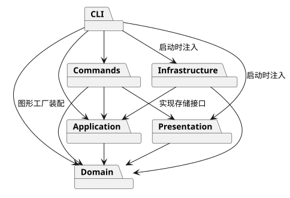
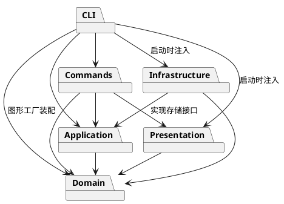

# Lab1 Phase 1：架构与开发记录

## 一、架构方案

### 1. 模块划分

| 目录 | 职责 |
| --- | --- |
| `src/domain/` | 封装图形、树结构、文档与几何行为；不依赖命令行或文件系统 |
| `src/application/` | 当前文档、编辑事务与历史管理；声明 SVG 存储接口 |
| `src/commands/` | 每条命令的对象与执行规则；编辑命令实现 Command 协议 |
| `src/cli/` | 分词、命令分发、REPL、统一错误输出与启动装配 |
| `src/infrastructure/` | SVG XML 解析与序列化、本地文件读写 |
| `src/presentation/` | 结构树和属性明细的文字展示 |
| `test/`、`examples/` | 自动化验证、可回放命令与外部 SVG 样例 |

下图由 PlantUML 在本机生成；可编辑源码见 [architecture.puml](architecture.puml)。





### 2. 设计模式的选择

- **Command（必选）**：编辑操作封装为独立命令对象，统一执行与撤销/重做。一条命令对应一个历史单元。
- **Composite**：抽象图形统一定义平移、缩放、属性和克隆；`Group` 持有子图形，递归执行几何操作；叶子图形只处理自身属性。
- **Memento**：编辑前后保存封装的文档副本。失败时恢复副本；历史用副本恢复整棵树、顺序和属性，避免每条复杂结构操作分别编写易错的逆操作。代价是每次编辑要复制文档，历史内存随文档大小和历史条数增长，适合本阶段小型文档。
- **依赖倒置**：应用层声明 SVG 存储接口，基础设施实现；命令不直接操作磁盘。
- **图形工厂 / 命令分发（待重构）**：仅这两处按名字选择实现。后续可改为插件注册，本阶段不建设完整插件框架。

实际代码落点：

| 角色 | 文件与行为 |
| --- | --- |
| 命令协议 / 具体命令 | `commands/Command.ts`、`commands/EditCommand.ts` 与各 `*Command.ts`；统一 execute，具体编辑实现 apply |
| 调用者 / 接收者 | `application/Editor.ts` 组织事务；`domain/SvgDocument.ts` 与图形对象执行结构和几何行为 |
| 历史 / 备忘录 | `application/History.ts` 管理过去与未来；`EditRecord.ts` 私有保存前后副本，并提供 undo/redo |
| 组合与叶子 | `domain/Shape.ts` 统一接口；`Group.ts` 递归；五类叶子通过 `GeometryShape.ts` 复用几何验证 |
| 两处分发（待重构） | `cli/CommandDispatcher.ts` 命令名表；`domain/ShapeFactory.ts` 类型名表；其他模块不按图形标签分派 |
| IO 端口 / 适配器 | `application/SvgStorage.ts` 声明端口；`infrastructure/FileSvgStorage.ts` 实现，`Main.ts` 注入 |

### 3. 依赖方向规则

图中箭头表示允许的直接依赖；各模块内部允许相互引用。

| 模块 | 允许依赖的其他业务模块 | 理由 |
| --- | --- | --- |
| domain | 无 | 独立封装图形行为与不变量 |
| application | domain | 编排文档与历史，不绑定交互方式和磁盘 |
| presentation | domain | 只读取模型，生成文本展示 |
| infrastructure | application、domain | 实现应用端口，转换 SVG 和模型 |
| commands | application、domain、presentation | 表达用户用例、调用核心、返回显示结果 |
| cli | 其他五个模块 | 作为组合根装配工厂、存储、命令和展示 |

Node IO 与第三方运行依赖只允许出现在 CLI 或基础设施。禁止领域层反向调用命令、展示或文件系统。`test/architecture.test.ts` 自动检查当前静态 import，违反规则即修正代码或如实修订方案。

### 4. 变化点假设

| 变化点 | 本阶段决策及理由 |
| --- | --- |
| 新增图形 / `box` 插件 | 统一图形协议并集中工厂分发；不实现 `box`、插件加载和恢复规则，因为不在 Phase 1 范围 |
| 新增命令与交互渠道 | 独立命令对象与应用层；REPL 仅负责文本输入输出，后续 GUI 可复用核心 |
| 撤销策略 / 大文档性能 | 历史集中管理；先用快照保证结构还原正确，未来可替换为差量历史 |
| SVG 存储介质 | 以接口隔离本地文件系统，测试可使用内存替身 |
| 显示格式 | 单独的展示类生成 tree/show，领域对象不打印 CLI 文本 |
| 任意完整 SVG 语法 | 本阶段实现六类图形与所需属性；超出范围的输入应显式处理，避免静默丢失 |

## 二、过程记录

### 2026-10-26 · 第一步：工程与方案

- 阅读 `phase_cli_1.md`，先区分 Phase 1 与未来插件阶段，确认 `box` 不实现。
- 采用分步 Git 提交，先建立严格类型检查和目录职责，再实现功能。
- 在需求审阅中识别两个容易误读的点：`#` 仅在注释行开头生效，颜色参数仍需保留；根级 `g` 按题目要求禁止 `ungroup`，即使常规编辑器可能允许。
- 架构方案选择 Command + Composite，并计划使用快照处理复杂结构的撤销和失败原子性，接受小型文档下的复制成本。
- 首次严格编译发现 Node 类型未被自动包含，显式配置 `types: ["node"]`，并启用 `noEmitOnError` 防止编译失败仍产出可运行文件。

以下记录本次与 Codex 协作的实际迭代；代码生成、自查与工具执行由 Codex 完成，没有把未发生的人工评审写成既成事实。

### 2026-10-26 · 第二步：领域模型

- 实现六类图形、嵌套容器和文档，字段私有；读取集合返回副本，避免调用方直接修改内部数组。
- 明确 `scale` 缩放位置和尺寸，而非只改大小；容器递归处理叶子。样式保留在容器上，使用 SVG 原生继承语义。
- 明确 SVG 后绘制的元素位于前方：`front` 移到兄弟末尾，`back` 移到开头。
- `group` 按原文档深度优先顺序收编，在第一个被选节点的位置插入新容器，跨父级也保持原遍历相对顺序；题目未规定新容器位置，这里作出确定性选择。
- 先测试几何、克隆、唯一 ID、容器层级、循环拒绝和顺序，再开始 CLI 集成。
- 测试环境禁止创建 tsx CLI 的 IPC 管道，改用 Node 原生的 `--import tsx` 启动；同样执行 TypeScript，但不依赖额外监听管道。

### 2026-10-26 · 第三步：命令与历史

- 各编辑命令继承 `EditCommand` 并实现 `EditAction`；`Editor` 是调用者，负责执行事务、捕获快照和交给历史管理。恢复副本由 `EditRecord.undo/redo` 完成。
- 解析器保留参数是否带引号，防止把文字内容 `"in"` 误认为父容器子句；同时保留颜色中的 `#`，支持空文字和转义双引号。
- 用针对性测试触发一个部分修改风险：容器前面的子图形缩放成功，后面的极大坐标溢出。确认编辑事务能还原全部子孙，失败不占用撤销单元。
- 17 项自动化测试通过，包含全部编辑命令的撤销/重做、IO 屏障中的 init/canvas、显示与失败编辑不破坏 redo、错误格式与状态不变。
- SVG 存储接口已声明，read/save 命令对象已建立；磁盘实现留在下一步提交，未把 IO 放进领域模型。

### 2026-10-26 · 第四步：SVG 读写

- 使用 XML DOM 库解析与序列化，不用正则表达式解析树；XML 解析警告也按失败处理，避免悄悄修复损坏文件。
- 审阅自动 ID 方案时发现：若边读边分配，前面的匿名 rect 可能占用后面已有的 `rect1`。改为先收集全文件显式 ID，再分配匿名 ID，并补充冲突测试。
- 外部 SVG 的 `transform`、`font-size`、`text-anchor`、`data-*` 等属性保留在封装模型中，保存和快照不丢失，但不扩大 CLI 的 `set` 白名单。导入后的几何编辑使用元素的局部坐标；不展开已有变换矩阵。跨变换容器调整归属保留局部几何值，不保证屏幕位置不变。
- 文件先写同目录临时文件再原子替换；失败不更改当前文档、默认路径或历史。只有成功的文档操作建立历史屏障。
- 26 项自动化测试通过；典型外部文件读入 7 个元素，缺 ID 的矩形得到 `rect1`；两节点流程图脚本成功导出 8 个元素。

### 2026-10-26 · 第五步：对照原文修正与端到端检查

- Codex 在对照原文时发现，最初把显式 `save B.svg` 的路径当作后续默认路径；原文要求无参数保存到“读入时的路径”。已修正：读入 A、另存 B 后，无参数 save 仍写 A；init 后没有读入路径，即使显式保存过，也仍需提供路径。加入回归断言防止再次偏离。
- 补齐 `group` 新 ID 的检查，避免只有 create 验证 ID、group 却能创建带空格 ID 的不一致。
- 通过真实子进程回放两个课程脚本，验证 REPL 遇到错误会继续、输出文件可读、8 元素流程图和 7 元素外部文件结构正确。
- 增加静态 import 方向与一类一文件检查，连同测试代码一起进行严格类型检查。静态规则检查仅覆盖当前使用的常规 import 声明，不能替代人工架构审查。
- 加入 GitHub Actions，在 Node.js 22、24 的 Linux 环境执行干净安装和全部检查；远程实际结果在最终验收时补充。
- 本地 31 项测试通过；离线 SVG 渲染预览确认两节点、连线和中文文字正确显示。内置浏览器阻止 `file://`，因此未把离线渲染声称为浏览器实测。
- 在线 PlantUML 渲染因未授权源码外传被自动审批拒绝，改为下载官方工具后在本机渲染，不向在线服务提交架构源码。
- 额外往返实验发现，CLI 输入的 CR/LF 文本会被 XML 规范的换行归一化改变。序列化时把字面 CR 写成字符引用 `&#13;`，增加测试确认中文、emoji、CR/LF 和 tab 都能保持。

### 2026-10-26 · 第六步：文档与交付核对

- 在临时目录运行官方便携 Java 与 PlantUML，使用 Smetana 本地布局生成实际 SVG 包图；工具不属于项目运行依赖，没有提交大型工具二进制。
- 对图与代码逐条比对，发现初稿漏画 CLI 对领域工厂的依赖，补充图和依赖规则，并如实记入修订表。
- 将一致性自查和质量保证的计划段落替换为实际结果、覆盖表和明确的实现范围。
- 本地 32 项测试及对应提交在 GitHub Node.js 22/24 的检查均通过，图形预览和交互提示符实测完成。最终文档作为单独提交保留，交付以 `final` 标签定位。

### 2026-10-28 · 复查一：编辑和导入后的文档必须可序列化

- 对照“保存为 SVG”和“失败不改变任何状态”复查输入边界，复现 `create text` 接受 NUL、到 save 才失败的问题；外部 `&#0;` 字符引用也能绕过原有的源文本检查，成功 read 后留下无法保存的文档。
- 先增加 3 项回归测试，确认均在旧实现失败，再将 XML 字符校验集中到领域层 `Value`，在文字、样式和导入属性进入模型时验证。序列化仍保留校验，不依赖输入方自律。
- 确认非法 create/set/read 均只输出一条 error，不修改文档、不消耗历史、不清空已有 redo，也不输出失败导入的临时 ID 警告；合法中文、emoji、换行和制表符仍可往返。
- 编译、类型检查和 35 项测试通过。目录、依赖方向及命令范围保持原方案，没有新增命令、图形或依赖。

## 三、一致性自查

### 1. 模块划分是否一致？

一致。最终源码有 `domain`、`application`、`commands`、`cli`、`infrastructure`、`presentation` 六个目录；`src/cli.ts` 是只负责启动的入口。`test/` 为自动化验证，`examples/` 为回放材料，`.github/workflows/` 为 CI，`doc/` 为提交文档，不是额外业务模块。

所有生产类采用一类一文件，类名与文件名相同；数据由私有字段和行为方法封装。接口和分词结果属于端口/传输类型，不替代有行为的图形模型。

### 2. 依赖方向是否一致？

最终静态检查通过，没有未处理的违规依赖。抽样核查：

- `Shape`、`Group`、`SvgDocument` 只引用领域类，没有 Node IO。
- `Editor` 只引用领域模型和本层的历史、存储接口，没有引用 `FileSvgStorage`。
- `FileSvgStorage` 实现 `SvgStorage`，Node fs 仅出现在基础设施。
- `Main` 负责注入 `FileSvgStorage`；`CommandDispatcher` 负责装配工厂和具体命令。
- `TreePresenter` 只读取领域类，命令可以调用展示层，展示层不反向引用命令。

修订记录：

| 修订 | 原因与处理 |
| --- | --- |
| 补画 CLI → Domain | 最终核对发现 CLI 装配 `ShapeFactory` 的实际依赖未画在初稿中；组合根依赖领域工厂合理，已更新图、规则与静态检查使其一致 |
| 增加静态检查和 CI | 不改变业务分层，为最终一致性提供可重复证据 |
| 使用 Smetana 本地布局 | 让 PlantUML 无需系统 Graphviz 就能渲染包图；不改变依赖含义 |

命令分发表和图形工厂的后续注册化重构仍保留为明确待处理项，不属于本阶段遗漏功能。

## 四、质量保证手段

### 1. 可重复验证

```sh
npm ci
npm run check
npm run --silent cli < examples/flowchart.commands
npm run --silent cli < examples/session.commands
```

`check` 执行生产编译、源码与测试的严格类型检查，以及 32 项自动化测试：

| 测试文件 | 数量 | 核心覆盖 |
| --- | --- | --- |
| `domain.test.ts` | 7 | 五类叶子几何、递归组合、克隆、ID、树操作、顺序与数值验证 |
| `commands.test.ts` | 10 | 六类创建、全部编辑命令、撤销重做、历史屏障、属性白名单、错误原子性、解析 |
| `svg.test.ts` | 11 | XML 往返、缺失/冲突 ID、Unicode 与换行、属性保留、读写失败、默认读入路径 |
| `cli.test.ts` | 2 | 启动真实 REPL 子进程，回放课程典型会话和流程图 |
| `architecture.test.ts` | 2 | 静态依赖方向、一类一文件与顶层过程式函数检查 |

用真实文件系统验证不可写文件、无效路径、失败不破坏历史，保存采用同目录临时文件加原子替换。用极大坐标溢出验证“部分子孙已修改”时仍能恢复整棵树。

### 2. 功能完整性核对

| 原文范围 | 实现与验证 |
| --- | --- |
| 文档命令 | init/read/save/canvas；默认 800×600、读入路径默认保存、查询不建立屏障 |
| 内置类型与创建归属 | rect/circle/ellipse/line/text/g；全部支持 create 的 in 子句；未注册类型含 box 报错 |
| 编辑命令 | delete/move/scale/set/group/ungroup/addto/front/back，容器与叶子统一路径 |
| 历史规则 | 每条编辑一个单元，成功新编辑清空 redo；IO 成功清空旧历史并锁定，下一条编辑解禁 |
| 显示 | tree 含关键几何属性，tree id 限定子树；show 含父级；help 含全部语法 |
| 通用约定 | svg> 提示符、注释行、双引号、浮点坐标、唯一大小写敏感 ID、统一 error 前缀、失败不改状态 |
| 导入导出 | 合法 SVG、缺 ID 自动补且警告、保存后可读回，六类图形和嵌套结构保持 |

终端 TTY 实测了 `svg>`、逐行输入、中文带空格文字与 show；脚本模式省略提示符，方便记录和回放。典型会话出现的非法分组与 save 后 undo 两条错误属于预期结果。

流程图离线渲染结果如下，已检查矩形、连接线、中文文字及撤销后的坐标：


### 3. 验证结果与范围

- 本机 Node.js 25.8.1：编译、类型检查和 32 项测试通过。
- GitHub Actions 在 Node.js 22、24 执行干净安装与检查，包含 32 项测试的提交 `68b5215` 已通过；记录见[本次检查](https://github.com/zxy0303/svg-editor-cli-lab1/actions/runs/40286340513)。
- 内置浏览器禁止打开本地文件，本次图像实测采用本地 SVG 栅格渲染，没有把它描述成浏览器兼容性测试。SVG 文件可交由普通浏览器手动预览。
- 历史使用整文档快照，时间与内存开销随文档大小和历史条数增长；未做大型文档性能优化。
- 这是六类图形的 SVG 子集编辑器。未知元素（如 path/tspan/defs）、损坏 XML、DTD/实体声明显式报错；不提供完整 SVG 语法支持。几何参数采用纯数值，根宽高额外接受 px 后缀，百分比及其他单位未实现。
- 外部额外属性可保留，但 CLI 只允许题目定义的 set 白名单；已有 transform 保留且编辑局部坐标，未做跨变换容器的世界坐标补偿。canvas 修改会重设 viewBox 为 `0 0 w h`。
- `box`、插件系统、图形界面属于后续阶段，按本阶段边界未实现。

### 4. 提交检查

代码和本文通过分步 Git 提交保留演进，远程仓库为 [zxy0303/svg-editor-cli-lab1](https://github.com/zxy0303/svg-editor-cli-lab1)。交付版本以最终提交上的 `final` tag 标识，并推送到远程；截止日期为 2026-10-31，具体时刻以课程平台为准。仓库为私有，课程提交前需确保评阅者可访问，具体课程平台提交入口未在题目中给出。

工具资料：[PlantUML 编码与渲染说明](https://plantuml.com/text-encoding)、[GitHub checkout](https://github.com/actions/checkout)、[GitHub setup-node](https://github.com/actions/setup-node)。架构图使用官方 PlantUML 1.2026.9 的本地渲染，不向在线服务发送源码。
